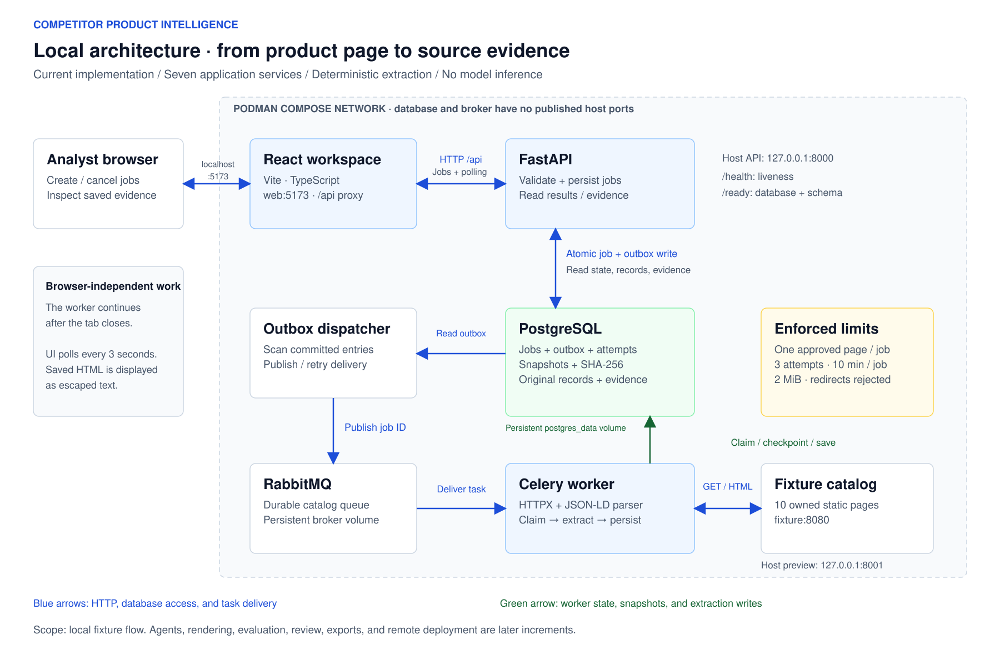

# Architecture

## Accepted decision and progress

The user accepted the baseline on 2026-10-21. Local implementation began on 2026-10-23. User-run output verified backend builds, migration `0001_local_jobs`, 21 backend tests, six healthy backend services, and the live API → outbox → RabbitMQ → worker → PostgreSQL smoke check with source evidence. Frontend image creation, TypeScript checking, the Vite production build, 3 component tests, and 1 Playwright browser test also passed. Screenshots and user observations confirmed UI submission, completed results, evidence inspection, and jobs retained after browser reload. A job queued while the worker was stopped completed with exactly one saved result and accessible evidence after worker restart. A cancelled queued job stayed cancelled with no result after restart. The user confirmed that all seven services became healthy after a full application stop/start and that an existing completed job's result and evidence remained accessible. The user subsequently reported the active-extraction crash-recovery follow-up complete; its output was not independently reinspected in this diagram review. The user saved the generated [frontend lockfile](frontend/package-lock.json), supplied its contents for review, and successfully rebuilt the web image using it through `npm ci`. Tests and production compilation initially passed before this rebuild. The user subsequently confirmed the post-lockfile tests/builds and remaining verification follow-ups complete. Control/reply and event queues use connection-exclusive lifetimes for RabbitMQ 4.3 compatibility; the job queue remains durable. Frontend container stages pin npm 11.6.0 after an npm 10 dependency-resolver failure. Documentation issue #1 was recorded as closed and Done. The user reports implementation issue #2 complete; its remote closure and board status were not confirmed during this review.

Remote hosting, inference hardware/model, costs, retention, and Vercel connectivity remain open. They do not block the first deterministic local working flow, which needs no model inference. Verify Vercel connectivity before committing to the remote integration design. Resolve hosting, budget, retention, and public-demo controls before public release. No providers, hardware, model, or costs have been selected, and no services have been provisioned.

## Current local architecture

[Editable draw.io source](assets/architecture/local-architecture.drawio) · [Vector SVG](assets/architecture/local-architecture.svg) · [High-resolution PNG (5400 × 3540)](assets/architecture/local-architecture.png)

This diagram represents the implemented local fixture flow. PostgreSQL is authoritative for job state and saved evidence; RabbitMQ carries durable tasks. The UI polls FastAPI through Vite's proxy. API, UI, and fixture host ports bind to localhost; database and broker ports stay inside Compose. The optional browser-test container is omitted from the runtime view. Agents, rendering, evaluation, review, exports, and remote hosting remain later increments.

The source and exports were authored together from the same layout, with editable draw.io cells and connectors. The SVG also embeds the draw.io model. Edit the source in diagrams.net and re-export SVG/PNG together to keep all three versions aligned. Diagram verification used source/configuration comparison, XML parsing, PNG metadata, and visual inspection; no application commands or tests were run.

## Components and responsibilities

The local `web` service uses React, Vite, TypeScript, Tailwind, and local shadcn/ui-style buttons/dialogs backed by Radix. Vite proxies `/api` to FastAPI; only localhost port 5173 is published for the UI. An optional `ui-tests` Compose profile uses Chromium/Playwright to test the live workflow. Component checks cover selected fields, retry idempotency, and pending submissions. Browser checks cover create, reload, saved results, escaped snapshot text, and dialog focus. Prior user-run results recorded above report these checks passing. The user subsequently confirmed post-lockfile tests/builds and the mobile/accessibility follow-up complete; no new runtime checks were performed for this diagram.

Accepted architecture baseline: shared FastAPI/Celery backend codebase and separate React frontend.  Uvicorn serves the local API. Pydantic defines contracts and emits JSON Schema; SQLAlchemy persists PostgreSQL data, with Alembic migrations. RabbitMQ carries durable Celery work; PostgreSQL is the authoritative job state.

HTTPX fetches the single owned fixture; Beautiful Soup and lxml parse its JSON-LD. Planned later increments add Playwright for Python with Chromium for rendering and LangGraph for three bounded roles: Discovery proposes product/pagination links; Extraction maps content to selected fields; Validation investigates conflicts and recommends acceptance, retry, or review. Code will validate recommendations and control tools. These rendering and agent capabilities are not implemented in the current flow.

## Processing and durability

UI → API → PostgreSQL job/outbox → RabbitMQ → Celery worker → snapshots/extractions → PostgreSQL → polled UI.

Commit job creation and an outbox entry together; a worker-side dispatcher publishes pending entries and tolerates duplicate delivery. Persist page checkpoints and attempts. Use unique job/canonical-URL constraints and idempotent result writes; preserve meaningful URL query parameters. Recover expired worker leases after crashes.

Discover static links and pagination within scope. Extract JSON-LD first, deterministic rules second, model assistance only when necessary. Apply deterministic validation before agent investigation.  Store prices as decimal amounts, currencies as explicit codes, and availability as a normalized value with raw evidence.

Proposed defaults: 20 unique pages including seeds/pagination, two retries per page, one concurrent request per domain, one request/second, 30-second request timeout, 2 MB response limit, ten-minute job deadline, 20 model calls, and 40,000 total model tokens. Bound graph steps to 30 per page, within the job budget. Reserve budgets atomically; retries consume request/model budgets but not additional unique-page slots. A budget stop preserves partial results with a reason. Cancellation checks precede work and writes; in-flight work has timeouts and cannot overwrite terminal state.

## Target API

This table describes the accepted target. The current API implements job creation/list/detail/cancellation, original records, evidence, `/snapshots/{id}` as plain text, `/health`, and `/ready`. Job listing supports limit/offset; records do not yet support pagination, filters, or an effective reviewed view. Review, export, and evaluation routes remain planned.

| Route | Responsibility |
|---|---|
| POST /jobs | Validate configuration; idempotently enqueue; return 202 and job ID |
| GET /jobs; GET /jobs/{id} | List jobs; return stage, counters, terminal reason |
| POST /jobs/{id}/cancel | Request idempotent cooperative cancellation |
| GET /jobs/{id}/records | Paginated, filtered original/effective records |
| GET /records/{id}/evidence | Safe excerpts and snapshot references |
| POST /records/{id}/reviews | Append correction, approval, or rejection; check revision |
| GET /jobs/{id}/export | CSV/JSON; automated/reviewed view; provenance |
| POST /evaluations; GET /evaluations/{id} | Enqueue run; return metrics and failures |
| GET /health | Minimal service health without secrets |

## Data and evidence

Initial local implementation: `jobs`, `job_outbox`, `snapshots`, and `product_records`. A job represents one page; attempt counts, leases, and attempt history are persisted on the job. For this bounded fixture flow, snapshot HTML and hashes are stored in PostgreSQL alongside metadata, using its existing durable volume. This avoids a separate storage service initially. External snapshot storage remains a later deployment decision. Records preserve original extracted fields; review events and extraction versions follow when human review is implemented. `/ready` checks the migrated database; a separate dispatcher scans committed outbox entries, while the Celery worker performs extraction. The recorded user-run smoke check verified the successful backend path and evidence integrity. Separate user checks covered queued-job recovery, queued-job cancellation, and retained result/evidence after a full stop/start. The user subsequently reported the active-extraction crash-recovery follow-up complete; its output was not independently reinspected in this diagram review.

Job owns configuration, budgets, outbox entries, PageTasks, and Attempts. PageTasks reference immutable Snapshots with URL, UTC observation time, content hash, and storage key. ProductRecord belongs to a job/page; immutable ExtractionVersions contain field values, null reasons, methods, and validation status. FieldEvidence links each candidate to a snapshot excerpt and locator. ReviewEvents append decisions and overrides; derive the effective view without mutating extraction. Separate validation status from human review status.

DatasetVersion owns labeled pages, expected product identities, field values, absence reasons, and evidence references. EvaluationRun links dataset, method, model/prompt versions, predictions, metrics, and failures. Snapshot bytes live in persistent storage; PostgreSQL stores metadata.

## Security and demo boundary

Permit approved HTTP(S) hosts/ports only. Validate seeds, every redirect, DNS resolution, and connection destination; reject loopback, private, link-local, reserved, metadata, and IPv6 equivalents. Enforce network egress controls against DNS rebinding. Apply the same policy to Chromium subresources, navigation, and downloads. Local fixtures use a narrow development exception unavailable in production.

Web content cannot grant tool permissions, change instructions, or access credentials. Models receive bounded content and typed tools. Escape evidence; sandbox any preview with scripts and network disabled. Prevent CSV formula execution. Keep broker, database, snapshots, inference credentials, and administrative operations private; restrict CORS, payload sizes, and logs.

Public demo: server-owned source presets, opaque job access tokens, per-client quotas, global concurrency/spend caps, isolated results, and expiry cleanup.

## Evaluation and testing

Start with ten labeled development snapshots. Compare deterministic, single-extraction-agent, and full workflow methods on identical bytes with fixed inputs and recorded versions. Evaluate discovery link precision/recall separately, then complete runs including missed products. Add held-out layouts and controlled layout changes for final portfolio assessment.

For expected non-null fields, correct predictions are TP; wrong non-null values add both FP and FN; null predictions add FN. Extra product predictions add FP and missed products add FN across applicable fields. Report precision, recall, F1, denominators, complete-record accuracy, evidence coverage/correctness, unsupported-value rate, review rate, failures, retries, runtime, and available model usage. Complete-record accuracy requires every selected field correct; missed expected products fail. Evidence coverage is the fraction of non-null predictions with evidence; correctness measures whether cited evidence supports them. Unsupported-value rate is the fraction of non-null predictions lacking support. Score absent-field null/reason correctness and spurious values separately. Preserve raw automated predictions; label corrected scores separately. Offline verified-label accuracy and live operational checks are distinct.

Use pytest for parsing, metric edge cases, URL security, budgets, and state transitions; integration tests for queue redelivery, recovery, migrations, and cancellation. Use frontend component tests for forms/review states and Playwright UI tests for the complete fixture journey. Validate evidence references and exports.

## File review and verification limits (2026-10-23)

Direct file inspection confirmed that the saved npm v3 lockfile matches the dependency declarations in `frontend/package.json`; its resolved package URLs use the public npm registry. Both frontend Docker stages permit this lockfile and use `npm ci` when present. Python transitive dependencies and container image digests are not fully locked.

The project file inventory contained no dependency/build folders, private key files, personal documents, or apparent private credentials in project text. The literal passwords in Compose, backend defaults, and `.env.example` are explicitly disposable local demo values. `.DS_Store` exists locally but is ignored and absent from the Git index. `.env` files, Python caches/virtual environments, `node_modules`, `dist`, and Playwright output are ignored. At that file review, the saved lockfile was not ignored, but it and the implementation files were not yet indexed. The user subsequently confirmed committing and pushing the implementation, documentation, and saved lockfile; remote delivery was not independently reinspected for this diagram. Git ignore rules do not remove already tracked files.

This review used filesystem reads and source/configuration comparison only. The runtime results above are retained from the existing project record; their original output was not available for independent reinspection in this review. No commands, tests, builds, services, or deployments were run. The user subsequently confirmed the post-lockfile tests/builds, active-extraction crash-recovery check, and mobile/accessibility review complete. Later evaluation and public-deployment acceptance checks remain outstanding. No model scores or extraction performance measurements are available.

## Deployment and delivery

Local Podman Compose runs seven application services: web, API, worker, dispatcher, RabbitMQ, PostgreSQL, and fixture, with persistent database/broker volumes. The optional test profile adds the browser-test container. Ollama/inference is not configured; select and integrate a local model through later evaluation.

Remote target: Vercel frontend and lightweight FastAPI API; independently hosted workers, broker, database, snapshot storage, and reachable inference. Jobs never depend on a browser or laptop. Verify offline-laptop operation, persistence, recovery, and the public journey before claiming deployment success. Provision nothing during documentation.

| Open decision | Working assumption / resolution trigger |
|---|---|
| Hosting and hardware | Select worker, RabbitMQ, PostgreSQL, snapshot providers and CPU/GPU capacity after baseline resource measurements. |
| Inference | Evaluate Ollama models locally; select hosted Ollama or compatible reachable inference before deployment. |
| Costs and retention | Set costs, monthly cap, quotas, and retention before public release. |
| Vercel API integration | Verify runtime limits, broker/database connectivity, TLS, and connection management before committing to the remote integration design. |
| Public-demo controls | Finalize and verify quotas, isolation, access controls, and cleanup before public release. |
| Public catalogs | Begin with owned fixtures; approve external sources and request policies after the basic workflow. |

Implementation sequence: (1) one deterministic controlled-page UI → API → worker → database → evidence flow; (2) ten labeled fixtures and baseline evaluation; (3) bounded agents and needed rendering; (4) review, exports, evaluation UI; (5) deployment and public verification.
