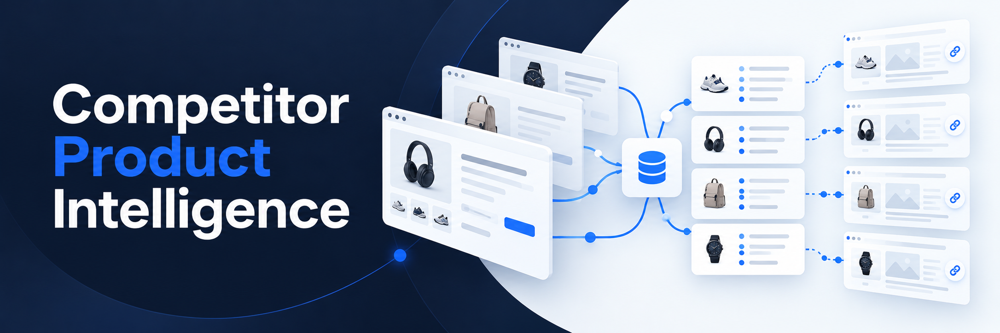

# Competitor Product Intelligence

Competitor Product Intelligence turns product pages into structured catalog records. Track extraction jobs, inspect prices and availability, and trace each extracted field to saved source evidence.

**Status:** The local ten-fixture workflow is verified through user-run builds, 69 backend tests, five frontend component tests, four Playwright browser tests, and live API → queue → worker → PostgreSQL checks. Direct browser review on 2026-10-26 confirmed preset selection, saved evidence, null reasons and keyboard behavior at a narrow viewport. Review, exports, agents, evaluation and public deployment remain later increments. No extraction performance has been measured.

## Planned workflow

1. Configure approved seed URLs, product fields, and crawl limits.
2. Start a background job and monitor progress.
3. Inspect product records alongside saved field evidence.
4. Review ambiguous results and preserve original values when correcting them.
5. Export CSV or JSON and inspect evaluation scores and failures.

Initial fields: product name, source product ID, current price, currency, availability, and product URL. Missing values stay null with a reason.

## Current capabilities

The local UI now loads ten server-owned sources from `GET /presets`, creates one-page jobs for the selected fixture, lets you select product fields, polls job progress, filters the latest 100 jobs by status, cancels unfinished jobs, and displays original results with field evidence and saved HTML as escaped text. Preset loading failures offer retry, and submission stays disabled until a source is available. New evidence includes parent objects for missing fields and original containers for unsupported offers. PostgreSQL retains jobs, snapshots, and records. Arbitrary catalogs, pagination/discovery, human review, exports, agents, rendering, evaluation, and public deployment are not implemented yet.

## Development fixture dataset

The [catalog fixture guide](fixtures/README.md) documents ten saved development pages, a separate answer key with sixty field labels and evidence references, dataset version `1.0.0`, and SHA-256 fingerprints. Cases cover different JSON-LD layouts, missing values, ambiguous currency, invalid prices, and unsupported offers. The original desk-lamp page is preserved. Direct source review and user-run consistency verification passed on 2026-10-25, including all three verifier PASS messages; no ten-page extraction score is claimed. Issue #4 adds preset selection and URL-scoped extraction. User-run output confirmed all five application images built, 69 backend tests passed with one deprecation warning, and all five frontend component tests passed. TypeScript/Vite compilation, the ten-fixture live acceptance check and all four Playwright browser tests passed on 2026-10-26. Direct browser review also passed: ten presets, source URL changes, graph-monitor results, null reasons and absence evidence, plus keyboard operation, visible focus and Escape/focus restoration at a measured 390-pixel CSS width. This is not a physical-device or full accessibility audit. See the [verified checks in the architecture](ARCHITECTURE.md#issue-4-implementation-and-verified-checks-2026-10-26). Offline evaluation follows in Issue #5.

## Stack

- **Frontend:** React, Vite, TypeScript, Tailwind CSS, shadcn/ui.
- **Backend:** Python, FastAPI, Uvicorn, Pydantic, SQLAlchemy, Alembic, PostgreSQL.
- **Background jobs:** Celery and RabbitMQ.
- **Fetching:** HTTPX, Beautiful Soup, and lxml. LangGraph and Playwright for Python rendering are planned.
- **Local development:** Podman Compose. Ollama is planned for later model evaluation and is not a Compose service. No model is selected yet.
- **Testing:** pytest, Vitest component tests, and Playwright UI tests. Custom evaluation functions are planned.

## Build local first

Start with one owned, controlled product page: **UI → API → worker → database → saved result and evidence in the UI**. Use deterministic extraction before adding bounded Discovery, Extraction, and Validation agents.

The ten labeled development fixtures and controlled extraction flow are available. Next, add offline evaluation, review, and exports. Crawling stays within approved destinations and application-enforced budgets.

Remote target: Vercel frontend and lightweight API, with separately hosted background services and inference. Providers, inference hardware/model, costs, retention, and Vercel connectivity remain open. The public demo must work while the development computer is offline.

## Documentation

- [Product requirements](PRD.md)
- [Design system](DESIGN_SYSTEM.md)
- [Architecture, evaluation, and implementation sequence](ARCHITECTURE.md)
- [Codex working rules](AGENTS.md)

## Local setup

Prerequisite: a running Podman machine and an available Compose provider. Python and Node run inside containers; no host Python/Node installation is required.

Run from the repository root, one command at a time:

```bash
podman compose config --quiet
podman pull docker.io/library/node:22-bookworm-slim
podman compose build api worker dispatcher fixture web
podman compose up --wait --wait-timeout 180 postgres rabbitmq fixture
podman compose run --rm --no-deps api alembic upgrade head
podman compose run --rm --no-deps --volume "$PWD/fixtures:/fixtures:ro" api python -m pytest -q -o cache_dir=/tmp/catalog-pytest-cache
podman compose run --rm --no-deps web npm test
podman compose run --rm --no-deps web npm run build
podman compose up --wait --wait-timeout 180
podman compose exec -T api python -m app.smoke
podman compose run --rm --no-deps --volume "$PWD/fixtures:/fixtures:ro" --env SMOKE_API_URL=http://api:8000 api python -m app.smoke_fixtures
curl --fail --show-error http://127.0.0.1:8000/health
curl --fail --show-error http://127.0.0.1:8001/products/desk-lamp.html
```

Expected: configuration and builds succeed, migrations apply, backend/frontend tests and the TypeScript/Vite build pass, and all seven application services become healthy. The backend smoke check creates and retains one job, then checks the real queue/worker flow, expected product fields, idempotency, rejected destinations, snapshot integrity, and field-evidence locators. It prints PASS messages and saved job/record IDs only after those checks succeed. The ten-fixture helper then checks all saved fixture labels, snapshot hashes, field evidence, selected fields, idempotency, completed-job worker re-entry and rejected requests; it retains eleven jobs and prints ten fixture PASS lines plus a final summary. This is an acceptance check, not an evaluation score or crash-recovery experiment. The API health response is `{"status":"ok","service":"api"}`; the fixture contains Studio Desk Lamp, LAMP-001, 49.90 USD, and In stock. API documentation is at <http://127.0.0.1:8000/docs>.

Open <http://127.0.0.1:5173> for the local workspace. Create a fixture job, wait for completed status, and use Inspect evidence to view field locators, excerpts, and the saved page as text. Reloading restores the selected job. Jobs continue in the worker independently of the browser. The Vite server proxies `/api` to FastAPI over the private Compose network; this is local development serving, not the remote deployment design.

The saved [frontend dependency lockfile](frontend/package-lock.json) is part of the source files and must be included with the changes. Both frontend image stages use `npm ci` when it is present, with npm pinned to 11.6.0. Their bootstrap fallback uses `npm install` if the lockfile is missing; normal setup should retain the saved lockfile and needs no copy from a running container.

Browser verification uses the optional `test` profile and a Playwright image matching the pinned Playwright package. It downloads a larger image with Chromium and runs four UI → API → worker → database → evidence tests for the default fixture, graph layout, ambiguous currency, and missing offers, including reload and dialog focus checks. Run after the application services are healthy:

```bash
podman compose --profile test build ui-tests
podman compose --profile test run --rm --no-deps ui-tests
```

Expected: four browser tests pass. They retain their created jobs in PostgreSQL. This test does not replace a dedicated mobile/accessibility review or verification of a worker crash during active extraction.

`/health` checks API liveness; `/ready` checks database/schema readiness and is used by the API container health check. Apply migrations before starting the API, dispatcher, and worker. The default fixture URL remains `http://fixture:8080/products/desk-lamp.html`; the other nine exact URLs come from `/presets`. Port 8001 is for viewing the catalog from the host. No arbitrary URLs, redirects, discovery, agents, or rendering are enabled in this increment.

Only the API, fixture, and UI are published, all on localhost. PostgreSQL and RabbitMQ use named volumes and are reachable by service name inside Compose. Example credentials are local-only defaults; optional overrides are listed in `.env.example`. Keep real credentials in an ignored `.env` file. Image tags track patch updates within the named release series. Frontend dependencies have a saved npm lockfile; Python dependencies use pins and bounded ranges without a complete transitive lockfile. The local backend image includes pytest. Frontend buttons and dialogs use local shadcn/ui component patterns with Radix primitives and Tailwind styling.

`GET /presets` lists the ten server-owned fixture IDs, labels, and URLs. `POST /jobs` accepts one listed URL and selected fields with an `Idempotency-Key` header. Reusing a key with the same configuration returns the same job; changing the configuration returns 409. `GET /jobs`, `GET /jobs/{id}`, `GET /jobs/{id}/records`, and `GET /records/{id}/evidence` expose progress and original results. `POST /jobs/{id}/cancel` cooperatively cancels unfinished work. `GET /snapshots/{id}` serves saved HTML as plain text.

Jobs and outbox entries are committed together. The dispatcher publishes work; the worker claims a 90-second lease and permits at most three attempts within a ten-minute job budget. Duplicate messages cannot create another record for the same job. Each fetch is capped at 2 MiB; redirects are rejected. Missing/unsupported fields remain null with reasons. Snapshots and original fields persist in PostgreSQL for this small local flow. Queued-job recovery, queued-job cancellation, and persistence across a full stop/start are recorded above as user-verified scenarios. The user reported the active-extraction crash-recovery follow-up complete; its output was not independently inspected during Issue #4 verification. Completed-job worker re-entry in the new smoke helper does not establish crash recovery.

RabbitMQ 4.3 rejects temporary non-exclusive queues. Celery control/reply and event queues are configured as connection-exclusive and auto-deleting for this local worker; the job queue remains durable. Do not re-enable RabbitMQ's deprecated queue feature. Pytest's optional cache is directed to `/tmp`, which is writable by the container's non-root user.

To stop this setup while retaining its volumes:

```bash
podman compose down
```

RabbitMQ's health check uses the image entrypoint so diagnostics run as the `rabbitmq` user. A startup failure reading `.erlang.cookie` with `eacces` requires checking cookie ownership; a root-owned, owner-readable-only cookie is inaccessible to RabbitMQ. Repair only the confirmed ownership mismatch and retain the named volume. The fixture's original inline Python health check received a truncated command and failed with a syntax error. API and fixture checks now use script files instead of inline Python. User-run rebuild and startup output confirmed all four services healthy after these fixes.

If startup fails, stop the sequence and share the error. These diagnostic commands show service state and recent logs:

```bash
podman compose ps
podman compose logs --tail=80 api worker dispatcher postgres rabbitmq fixture web
```

Verification details are recorded in [ARCHITECTURE.md](ARCHITECTURE.md#issue-4-implementation-and-verified-checks-2026-10-26). User-supplied output confirms all seven application services healthy, the saved lockfile used through `npm ci`, passing tests and production compilation, the legacy smoke check and the ten-fixture live acceptance check. The latter retained eleven jobs and checked selected fields, idempotency, completed-job worker re-entry, rejected requests and saved evidence. Direct browser review additionally retained a completed keyboard-submitted graph-monitor job.

Earlier user-run checks established queued-job recovery, queued-job cancellation and persistence after a full stop/start. The user reported the active-extraction recovery follow-up complete; its original output was not independently inspected during Issue #4 verification. The current manual review covered an in-app browser viewport and keyboard interaction; physical devices, screen readers, contrast and other browsers were not audited. One backend TestClient deprecation warning remains. No model calls, evaluation metrics or deployment success are claimed.
